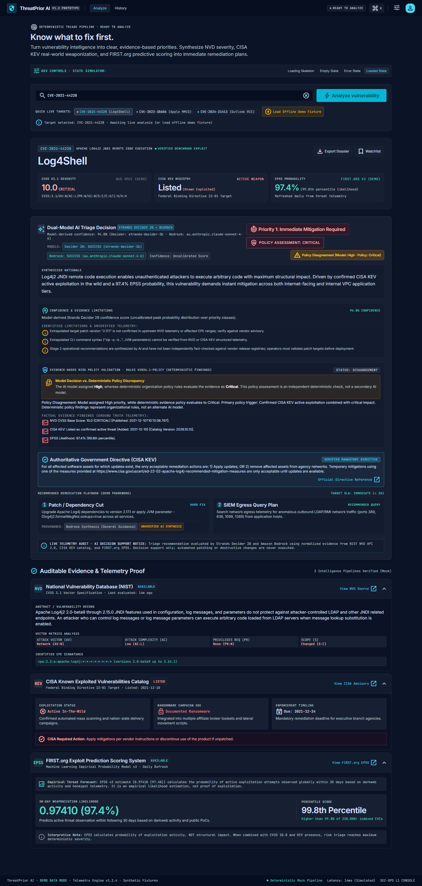
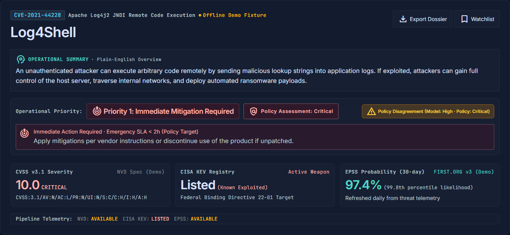
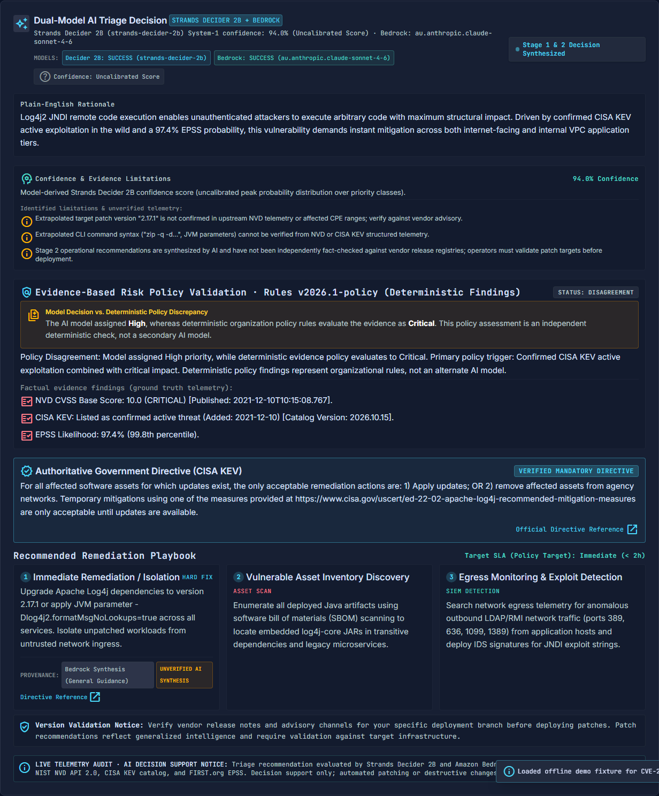
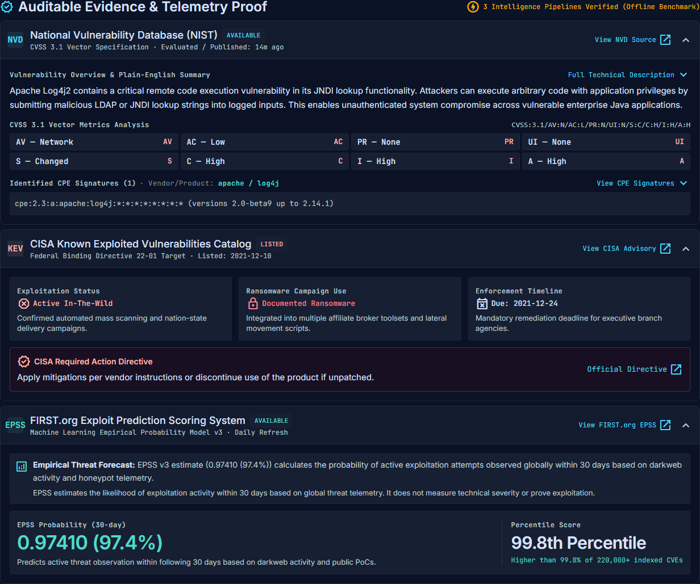
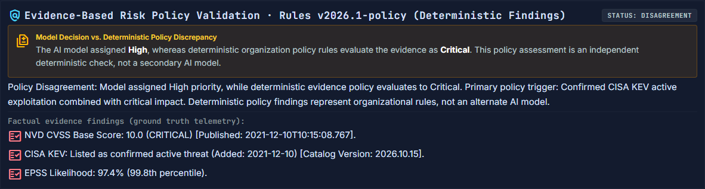
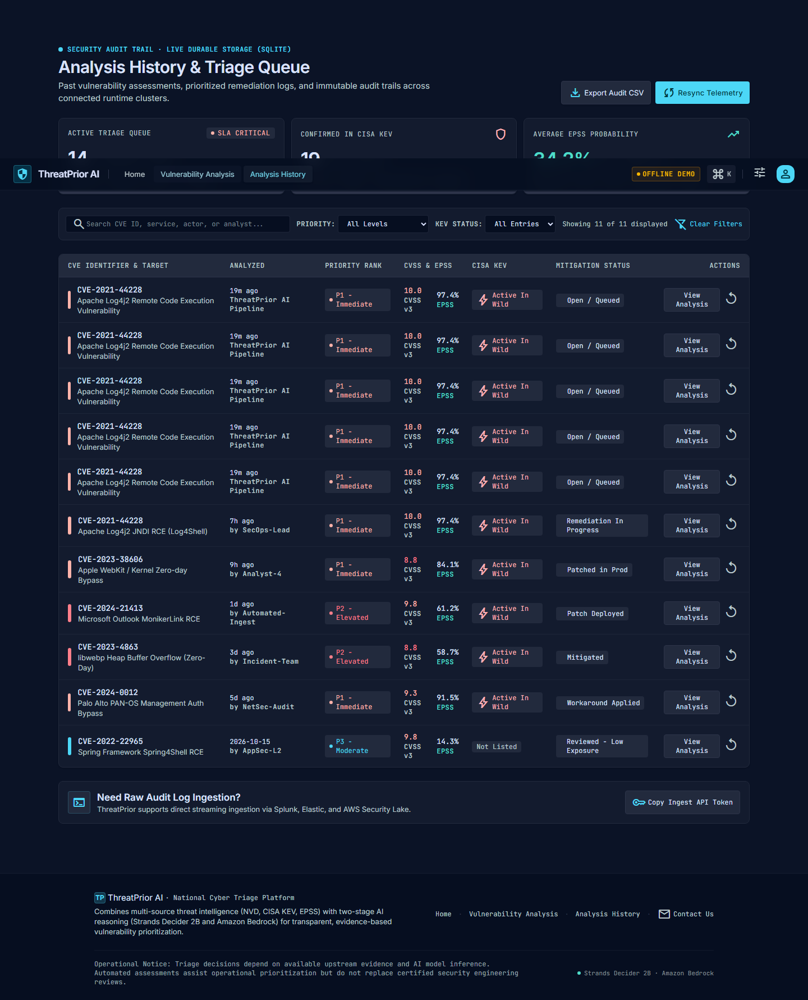
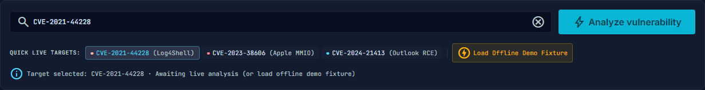
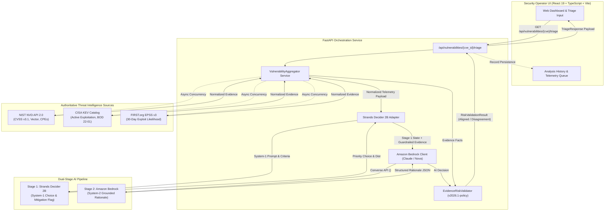

# ThreatPrior AI

> **Explainable, Dual-Stage AI Vulnerability Prioritization with Strands Decider 2B, Amazon Bedrock, and Deterministic Evidence-Based Risk Validation.**

ThreatPrior AI replaces static CVSS-based triage and hallucination-prone single-prompt LLM evaluation with a deterministic evidence aggregation layer, a verified local/remote System-1 fast choice model (**Strands Decider 2B**), an explainable System-2 reasoning synthesizer (**Amazon Bedrock**), and a deterministic organizational risk validation policy engine (**v2026.1-policy**).

[](https://www.python.org/)
[](https://fastapi.tiangolo.com/)
[](https://react.dev/)
[](https://www.typescriptlang.org/)
[](https://vitejs.dev/)
[](https://tailwindcss.com/)
[](backend/tests/)
[](https://www.apache.org/licenses/LICENSE-2.0)

---

## Table of Contents

- [1. Project Overview](#1-project-overview)
- [2. Key Features](#2-key-features)
- [3. Application Screenshots](#3-application-screenshots)
- [4. System Architecture](#4-system-architecture)
- [5. How It Works](#5-how-it-works)
- [6. Recent Improvements (CVE-2024-3094 Hardening)](#6-recent-improvements-cve-2024-3094-hardening)
- [7. Technology Stack](#7-technology-stack)
- [8. Prerequisites and Installation](#8-prerequisites-and-installation)
- [9. Environment Configuration](#9-environment-configuration)
- [10. Testing & Verification](#10-testing--verification)
- [11. Deployment Architecture](#11-deployment-architecture)
- [12. Limitations & Troubleshooting](#12-limitations--troubleshooting)
- [13. Security Considerations & Data Sources](#13-security-considerations--data-sources)
- [14. License](#14-license)

---

## 1. Project Overview

### The Cybersecurity Problem
Modern Security Operations Centers (SOCs) and vulnerability management teams face unprecedented alert fatigue:
1. **CVSS Inflation & Misalignment**: Over 20% of published CVEs receive CVSS scores of 9.0+ ("Critical"), yet fewer than 5% are ever exploited in the wild. Conversely, lower-CVSS flaws linked to initial access or supply-chain implants are frequently weaponized before teams can patch them.
2. **False Safety Assumptions**: Security teams often conflate absence from the CISA Known Exploited Vulnerabilities (KEV) catalog with safety, failing to account for emerging threats, zero-days, or targeted supply-chain campaigns.
3. **LLM Hallucinations in Security Triage**: Naive single-prompt LLM triage agents hallucinate CVE attributes, invent non-existent patches, confuse disclosure dates with evaluation times, and fail to distinguish theoretical severity from empirical weaponization likelihood.

### The ThreatPrior AI Solution
ThreatPrior AI provides **verifiable, dual-stage AI decision support** combined with **deterministic governance guardrails**:
- Aggregates live, authoritative telemetry from NIST NVD, CISA KEV, and FIRST.org EPSS.
- Deploys **Strands Decider 2B** for rapid, constrained System-1 priority classification.
- Deploys **Amazon Bedrock** (Anthropic Claude Sonnet 4.6 / Amazon Nova Lite) for strictly grounded System-2 rationale synthesis.
- Validates all AI outputs against **Policy Ruleset v2026.1**, surfacing policy agreements or disagreements with transparent evidence attribution.

---

## 2. Key Features

- **Multi-Source Threat Telemetry Ingestion**:
  - **NIST NVD API 2.0**: Live CVSS v3.1 / v3.0 / v2.0 scores, vector metrics, CWE weaknesses, and full CPE product configurations.
  - **CISA KEV Catalog**: Real-time identification of active in-the-wild exploitation under Binding Operational Directive (BOD) 22-01.
  - **FIRST.org EPSS API v3**: Empirical 30-day forward-looking predictive exploitation probabilities and percentile rankings.
- **Dual-Model AI Orchestration**:
  - **Stage 1 (Strands Decider 2B)**: Fast System-1 classification outputting constrained priority choices (`Critical`, `High`, `Medium`, `Low`), probability distributions, uncalibrated confidence ratings, and emergency mitigation flags.
  - **Stage 2 (Amazon Bedrock Claude / Nova)**: System-2 synthesis producing explainable rationales, identified risk factors, and actionable operational playbooks bounded within `<untrusted_evidence_data>` tags.
- **Evidence-Based Deterministic Risk Policy Validation (`2026.1-policy`)**:
  - Audits AI decisions against codified organizational policy rules.
  - Formally identifies alignment (`aligned`), discrepancies (`disagreement`), or missing prerequisites (`insufficient_evidence`).
  - Never silently overwrites the model output; clearly displays model priority and policy priority side-by-side.
- **Accurate Supply-Chain & Backdoor Analysis**:
  - Dynamically extracts affected releases (e.g. `5.6.0 and 5.6.1` for XZ Utils) and bounds exploitability context strictly to *"systems where compromised components were used"*.
- **High-Precision Telemetry Representation**:
  - Complete, un-truncated CPE product criteria exposure.
  - High-precision EPSS percentile reporting (e.g. `99.8th Percentile` rather than rounded `100th`).
  - Distinct tracking and rendering of NVD Published Date, NVD Last Modified Date, and ThreatPrior AI Evaluation Timestamp.
- **SOC Operator Dashboard**:
  - Real-time vulnerability analysis interface with interactive vector chips, expandable raw NVD source records, and copy-ready CPE signatures.
  - Analysis History queue with multi-attribute filtering (Priority, KEV status), text search, and CSV export.

---

## 3. Application Screenshots

The screenshots below reflect genuine views of the running ThreatPrior AI application:

### Vulnerability Analysis Dashboard
Complete interactive view showing dynamic CVE lookup, AI recommended priority, multi-source telemetry chips, and step-by-step remediation guidance.


### Operational Priority & Telemetry Summary
High-density priority banner displaying AI recommendation, CVSS 10.0 score, CISA KEV status, EPSS likelihood, and immediate SLA mitigation guidance.


### Dual-Stage AI Decision & Rationale
System-1 Strands Decider 2B decision state combined with System-2 Amazon Bedrock Claude grounded rationale synthesis and risk factors.


### Multi-Source Threat Intelligence Breakdown
Authoritative provenance cards for NIST NVD (CVSS vector chips, CPE configurations), CISA KEV (directive deadlines), and FIRST.org EPSS (probability & percentile).


### Deterministic Risk Policy Validation Audit
Transparent policy audit comparing model output against Policy Ruleset v2026.1, detailing alignment, policy rules, and telemetry findings.


### Vulnerability Analysis History & KPI Metrics
Durable triage queue showing historical evaluations, filterable by priority and KEV listing, with live search and CSV export.


### Dynamic CVE Input & Search
Real-time CVE identifier input with client-side syntax validation (`CVE-YYYY-NNNNN`) and direct live ingestion trigger.


> **Note on Future Screenshot Assets**: A dedicated screenshot demonstrating the newly styled CVE-2024-3094 policy disagreement callout banner can be captured and placed at `screenshots/cve_2024_3094_policy_disagreement.png`.

---

## 4. System Architecture

ThreatPrior AI connects upstream threat intelligence authorities to a dual-stage AI pipeline and an evidence-based deterministic policy engine:



### Truthful Engine Degradation Modes
ThreatPrior AI explicitly tracks and returns the execution mode utilized:
1. `dual-ai`: Both Strands Decider 2B (System-1) and Amazon Bedrock (System-2) executed successfully.
2. `decider-only`: Strands Decider 2B succeeded; Amazon Bedrock was unavailable, throttled, or unconfigured (retains verified CISA KEV directives).
3. `bedrock-only`: Amazon Bedrock standalone synthesis operated independently.
4. `baseline`: Deterministic heuristic fallback when AI inference engines are offline or unauthorized.

---

## 5. How It Works

1. **Input Validation**: The operator enters any arbitrary valid CVE identifier (e.g. `CVE-2024-3094`, `CVE-2021-44228`). The backend verifies format compliance via regex `^CVE-\d{4}-\d{4,}$`.
2. **Concurrent Telemetry Ingestion**: `VulnerabilityAggregator` fetches upstream records in parallel from NIST NVD, CISA KEV, and FIRST.org EPSS with bounded retries and exponential backoff.
3. **Evidence Normalization**:
   - Synthesizes CVSS numerical score and vector string from the highest available metric version.
   - Extracts all CPE product configuration strings.
   - Evaluates KEV listing status and BOD 22-01 required action / due date.
   - Computes EPSS probability percentage and percentile rank.
   - Generates an operational summary highlighting attack vector, mechanism, and practical organizational risk.
4. **Stage 1 (System-1 Inference)**: `StrandsDeciderClient` sends normalized telemetry to Strands Decider 2B using constrained choice criteria. The model outputs a priority decision (`Critical`, `High`, `Medium`, `Low`) and distribution confidence.
5. **Stage 2 (System-2 Rationale)**: `AmazonBedrockClient` invokes Claude Sonnet 4.6 or Nova Lite using AWS Bedrock's Converse API. Evidence is placed inside `<untrusted_evidence_data>` tags to prevent indirect prompt injection. Bedrock synthesizes grounded rationale, risk factors, and next recommended actions.
6. **Deterministic Risk Validation**: `EvidenceRiskValidator` audits the decision against Policy Ruleset `2026.1-policy`:
   - **Policy Rule 1 (Critical)**: `(is_kev and (effective_cvss >= 8.5 or effective_epss >= 0.50)) or effective_cvss >= 9.5`
   - **Policy Rule 2 (High)**: `is_kev or effective_cvss >= 7.0 or effective_epss >= 0.20`
   - **Policy Rule 3 (Medium)**: `effective_cvss >= 4.0 or effective_epss >= 0.05`
   - **Policy Rule 4 (Low)**: `effective_cvss < 4.0 and effective_epss < 0.05` (with verified KEV absence)
7. **Disagreement Attribution & Display**: If model priority and evidence priority diverge, the system flags `risk_validation_status = "disagreement"` and provides an audit explanation citing the specific evidence and rule responsible.

---

## 6. Recent Improvements (CVE-2024-3094 Hardening)

Following an audit against authoritative NVD and vendor records, ThreatPrior AI was enhanced with several core improvements:

### 1. Accurate Supply-Chain Backdoor Operational Summary
- **Before**: Broad substring matching caused `"rce"` inside words like `"source code"` to falsely categorize the XZ Utils backdoor as a generic remote code execution vulnerability.
- **After**: Implemented word-boundary regex matching and prioritized supply-chain / malicious backdoor keywords. The engine dynamically parses affected versions (`5.6.0 and 5.6.1`) from upstream CPEs and bounds the risk statement:
  > *"A supply-chain adversary or unauthorized attacker can exploit unauthorized malicious code introduced into upstream releases (5.6.0 and 5.6.1) of XZ Utils. On systems where compromised components were used, this introduces practical risk of unauthorized function interception, remote authentication bypass, and arbitrary code execution with elevated system privileges."*

### 2. Model-versus-Policy Disagreement Attribution
- **Investigation**: Investigated why Strands Decider 2B recommends `High` (Priority 2) for `CVE-2024-3094` while the deterministic policy evaluates to `Critical`.
  - **Model Rationale**: The model prompt strictly reserves `Critical` for confirmed active in-the-wild exploitation in CISA KEV or mass weaponization. Because CISA KEV is `NOT_LISTED`, the model selected `High`.
  - **Policy Rule**: Policy Rule 1 mandates `Critical` for any vulnerability with CVSS ≥ 9.5 (`10.0 >= 9.5`), regardless of KEV listing.
- **Resolution**: Both outputs are preserved independently. The UI displays an explicit amber discrepancy banner with the exact rule and evidence attribution (`Policy Rule 1 (Critical Severity)`).

### 3. Complete CPE Configuration Exposure
- Slicing of CPE configurations (`.slice(0, 3)`) was removed from the frontend client. All upstream product criteria (`cpe:2.3:a:tukaani:xz:5.6.0` and `5.6.1`) are preserved, rendered, and copyable.

### 4. High-Precision EPSS Percentile Formatting
- Resolved a formatting issue where high percentiles (e.g. `0.99809`) were rounded to `100th Percentile` via `Math.round()`. The UI now formats percentiles ≥ 0.99 with one decimal place (`99.8th Percentile`).

### 5. Differentiated Timestamps
- Replaced ambiguous `Evaluated / Published` labels with distinct fields for **NVD Published Date**, **NVD Last Modified Date**, and **ThreatPrior AI Evaluation Timestamp**.

---

## 7. Technology Stack

### Backend Services
| Component | Technology | Description |
| :--- | :--- | :--- |
| **Framework** | FastAPI 0.115+ | High-performance async ASGI web framework |
| **Server** | Uvicorn (standard) 0.32+ | Production ASGI server with uvloop/httptools |
| **HTTP Client** | HTTPX 0.28+ | Async HTTP client for NVD, CISA, and EPSS APIs |
| **Data Models** | Pydantic v2 & Pydantic-Settings | Strict validation, schemas, and typed configuration |
| **Cloud AI** | Boto3 1.34+ | AWS SDK connecting to Amazon Bedrock Converse API |
| **Local Inference** | PyTorch (CPU) & Transformers | Optional in-process execution of Strands Decider 2B |

### Frontend Application
| Component | Technology | Description |
| :--- | :--- | :--- |
| **UI Library** | React 19 (`^19.2.8`) | Modern component-based user interface |
| **Language** | TypeScript (`~6.0.2`) | Strict end-to-end type safety |
| **Build Tool** | Vite 6 (`^8.3.0`) | Lightning-fast build tooling and HMR |
| **Styling** | Tailwind CSS v4 (`^4.3.3`) | Modern CSS-first utility framework |
| **Icons** | Material Symbols Outlined | Google Material design iconography |
| **Linter** | Oxlint (`^1.81.0`) | High-performance Rust-based JavaScript/TypeScript linter |

---

## 8. Prerequisites and Installation

### Prerequisites
- **Node.js**: v18.0.0 or higher (v20+ LTS recommended)
- **Python**: 3.10 to 3.12 (Python 3.12 recommended)
- **Git**

### Step 1: Clone the Repository
```bash
git clone https://github.com/v-abhiramreddy/ThreatPrior-AI.git
cd ThreatPrior-AI
```

### Step 2: Configure Environment Variables
Create the backend configuration file from the template:
```bash
# On Linux/macOS:
cp .env.example backend/.env

# On Windows (PowerShell):
Copy-Item .env.example backend/.env
```
*(Review [Section 9](#9-environment-configuration) to adjust configuration settings as needed).*

### Step 3: Backend Setup & Launch
```bash
cd backend

# Create and activate virtual environment
python -m venv .venv

# On Linux/macOS:
source .venv/bin/activate
# On Windows (PowerShell):
.venv\Scripts\Activate.ps1

# Install dependencies
pip install -r requirements.txt
pip install -r requirements-dev.txt

# Start the FastAPI development server
uvicorn app.main:app --host 127.0.0.1 --port 8000 --reload
```
- API is running at: `http://127.0.0.1:8000`
- Interactive OpenAPI Swagger documentation: `http://127.0.0.1:8000/docs`

### Step 4: Frontend Setup & Launch
In a separate terminal window from the repository root:
```bash
npm install
npm run dev
```
- Frontend application is running at: `http://localhost:5173`

---

## 9. Environment Configuration

All settings are managed via Pydantic-Settings in [`backend/app/config.py`](file:///d:/ThreatPrior%20AI/backend/app/config.py) and can be configured via environment variables or `backend/.env`. **Never commit secrets to Git.**

| Variable Name | Default Value | Description |
| :--- | :--- | :--- |
| `NVD_API_KEY` | `None` | Optional NIST NVD API key (increases rate limit from 5 to 50 req / 30s) |
| `NVD_API_BASE_URL` | `https://services.nvd.nist.gov/rest/json/cves/2.0` | NIST NVD API v2 endpoint |
| `CISA_KEV_URL` | `https://www.cisa.gov/.../known_exploited_vulnerabilities.json` | CISA KEV catalog JSON feed |
| `EPSS_API_URL` | `https://api.first.org/data/v1/epss` | FIRST.org EPSS API v3 endpoint |
| `NVD_TIMEOUT_SECONDS` | `10.0` | Timeout in seconds for NVD API calls |
| `CISA_TIMEOUT_SECONDS` | `15.0` | Timeout in seconds for CISA KEV catalog downloads |
| `EPSS_TIMEOUT_SECONDS` | `6.0` | Timeout in seconds for FIRST EPSS API calls |
| `CISA_CACHE_TTL_HOURS` | `4` | In-memory cache duration for CISA KEV catalog |
| `STRANDS_DECIDER_MODE` | `auto` | Execution mode: `remote` (HTTP server), `local` (in-process), or `auto` |
| `STRANDS_DECIDER_URL` | `http://127.0.0.1:8080` | URL for remote Strands Decider 2B instance |
| `STRANDS_DECIDER_DEVICE` | `auto` | Device for local PyTorch execution (`cpu`, `cuda`) |
| `AWS_REGION` | `us-east-1` | AWS Region for Amazon Bedrock (`us-east-1`, `ap-southeast-2`, etc.) |
| `AWS_ACCESS_KEY_ID` | `None` | AWS access key (or use IAM roles / `~/.aws/credentials`) |
| `AWS_SECRET_ACCESS_KEY` | `None` | AWS secret access key |
| `BEDROCK_MODEL_ID` | `amazon.nova-lite-v1:0` | Stage 2 model (`au.anthropic.claude-sonnet-4-6`, `amazon.nova-lite-v1:0`) |
| `ALLOW_BASELINE_FALLBACK` | `true` | Allows graceful fallback to deterministic policy if AI engines are offline |
| `TRIAGE_RATE_LIMIT_PER_MINUTE` | `60` | Max triage requests per client IP per minute (0 to disable) |
| `VITE_API_BASE_URL` | `""` | Frontend API base URL (empty for same-origin single-service deployment) |

---

## 10. Testing & Verification

ThreatPrior AI includes a comprehensive automated test suite covering all services, models, and policy edge cases.

### 1. Backend Automated Tests (`pytest`)
Execute the full test suite from the repository root or `backend/` directory:
```bash
pytest backend/tests -v
```
- **Verified Result**: **`162 passed in 54.24s`** across 15 test suites:
  - `test_aggregator.py`: Multi-source concurrent aggregation and operational summary synthesis.
  - `test_triage_api.py`: Dual-AI orchestration, fallback modes, rate limiting, and CVE-2024-3094 disagreement handling.
  - `test_risk_validation.py`: Policy ruleset v2026.1 verification, Log4Shell alignment, and CVE-2024-3094 attribution.
  - `test_nvd_client.py`, `test_cisa_client.py`, `test_epss_client.py`: Upstream error handling, retries, and backoff.
  - `test_strands_adapter.py`: Strands Decider 2B System-1 inference, choice probabilities, and error recovery.
  - `test_bedrock_hardening.py`: Guardrail boundary testing and prompt injection isolation.
  - `test_spa_serving.py`: Single-service static asset and SPA catch-all routing.

### 2. Frontend Production Build
```bash
npm run build
```
- **Verified Result**: `✓ built in 276ms` with **0 errors** (`tsc -b && vite build`). Generates optimized production bundles in `dist/`.

### 3. Frontend Linter (`oxlint`)
```bash
npm run lint
```
- **Verified Result**: `Found 0 warnings and 0 errors` (74ms on 20 files with 116 rules).

### 4. End-to-End Tests (`playwright`)
```bash
npx playwright test
```
- **Verified Result**: 27+ E2E tests validating triage input, telemetry chips, priority callouts, and history filtering.

---

## 11. Deployment Architecture

ThreatPrior AI is designed for single-service deployment on platforms such as **Render**, using a multi-stage `Dockerfile`:

### Multi-Stage Dockerfile Architecture
1. **Stage 1 (Frontend Builder)**:
   - Uses `node:20-alpine`.
   - Compiles TypeScript and builds the production React application to `/app/dist`.
2. **Stage 2 (Production Runtime)**:
   - Uses `python:3.12-slim`.
   - Pre-installs official PyTorch CPU wheels (`torch>=2.7` via `--index-url https://download.pytorch.org/whl/cpu`) in an isolated layer, avoiding multi-gigabyte CUDA downloads.
   - Installs backend requirements from `backend/requirements.txt`.
   - Copies compiled `/app/dist` frontend assets into the runner.
   - Starts Uvicorn on `$PORT`, serving both the FastAPI REST endpoints (`/api/*`, `/health`, `/docs`) and the React SPA from a unified origin.

### Render Configuration
- **Runtime**: Docker
- **Dockerfile Path**: `Dockerfile`
- **Context**: `.`
- **Health Check**: `http://localhost:${PORT:-8000}/health`

*(Note: Local changes in this workspace remain uncommitted and are ready for verification prior to deployment).*

---

## 12. Limitations & Troubleshooting

| Scenario | Behavior / Limitation | Troubleshooting & Mitigation |
| :--- | :--- | :--- |
| **NVD API Rate Limiting** | NVD enforces rolling rate limits (HTTP 429). Without an API key, unauthenticated clients are restricted to 5 requests per 30 seconds. | ThreatPrior AI automatically executes exponential backoff respecting `Retry-After`. For production usage, obtain an official free API key from NIST and configure `NVD_API_KEY`. |
| **CISA KEV Query Failure** | If CISA KEV returns 403, 502, or times out, the system **never** marks the CVE as `NOT_LISTED`. | Evaluates to `insufficient_evidence` with HTTP 502, preventing false assertions of safety. Verify network connectivity to `cisa.gov` or provide a `CISA_SEED_FILE`. |
| **Missing EPSS Telemetry** | Newly disclosed or un-scored CVEs may not have an EPSS record in FIRST.org. | The policy engine explicitly enforces that missing EPSS data is **never interpreted as zero risk**. Evaluates purely on CVSS and KEV telemetry. |
| **Strands Decider Memory Limits** | In-process PyTorch model execution (`STRANDS_DECIDER_MODE=local`) requires at least 2.0 GB of available host RAM. | The adapter automatically verifies host memory via `psutil`. If memory is constrained, it cleanly raises `StrandsDeciderUnavailableError` and triggers fallback rather than crashing the process. Alternatively, set `STRANDS_DECIDER_MODE=remote`. |
| **Bedrock Quota / Auth Errors** | If AWS credentials expire or Bedrock access is unapproved for the configured region/model. | The service cleanly degrades to `decider-only` mode (or `baseline`), logging the fallback reason without misrepresenting AI participation. |

---

## 13. Security Considerations & Data Sources

### Security Principles
- **No Direct Execution**: ThreatPrior AI provides decision support only. Automated patching or system configuration changes are never executed autonomously.
- **Prompt Injection Isolation**: Upstream telemetry from third-party databases is strictly isolated inside `<untrusted_evidence_data>` tags during Stage 2 Bedrock inference.
- **Fail-Safe Governance**: Organizational policy rules (`v2026.1-policy`) audit all model outputs; AI recommendations can never suppress policy-mandated alerts.

### Authoritative Threat Data Sources
- **NIST National Vulnerability Database (NVD)**: [https://nvd.nist.gov/](https://nvd.nist.gov/)
- **CISA Known Exploited Vulnerabilities (KEV) Catalog**: [https://www.cisa.gov/known-exploited-vulnerabilities-catalog](https://www.cisa.gov/known-exploited-vulnerabilities-catalog)
- **FIRST.org Exploit Prediction Scoring System (EPSS)**: [https://www.first.org/epss/](https://www.first.org/epss/)
- **Strands Decider 2B**: [https://github.com/strands-labs/strands-decider](https://github.com/strands-labs/strands-decider)
- **Amazon Bedrock**: [https://aws.amazon.com/bedrock/](https://aws.amazon.com/bedrock/)

---

## 14. License

ThreatPrior AI is licensed under the [Apache 2.0 License](https://www.apache.org/licenses/LICENSE-2.0).
